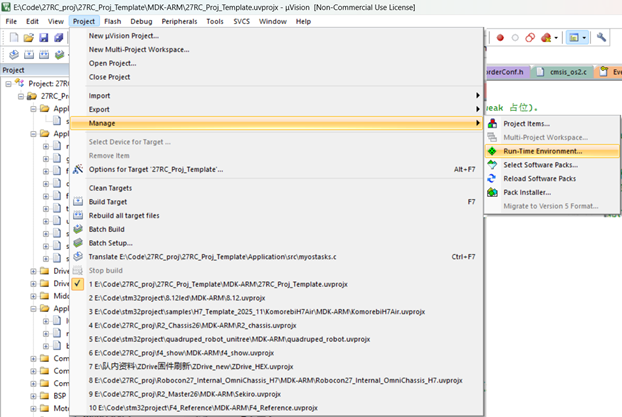
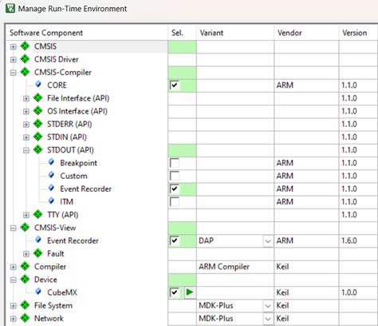
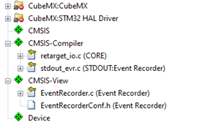
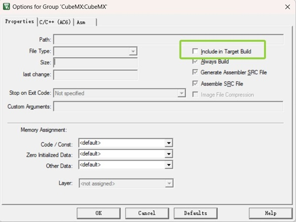
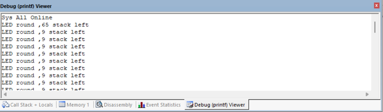
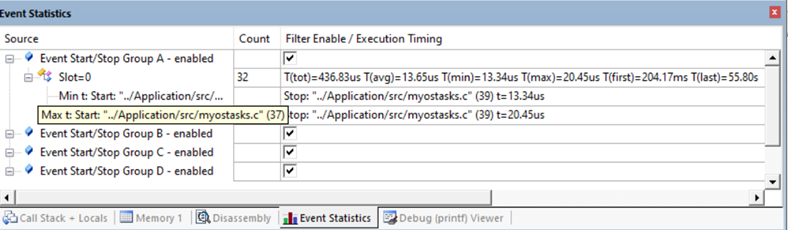

# Event Recorder 工程使用说明

## 1. 简介

Event Recorder 是 ARM CMSIS-View 提供的运行时调试工具，可记录程序运行过程中产生的事件，并在 Keil µVision 中进行查看。

当前工程未启用 Event Recorder；本文保留团队的可选调试配置方法。常规调试使用 Keil Watch 和 VOFA，按需通过 RTE 添加 Event Recorder 组件。

本文仅介绍 Event Recorder 在本工程中的配置、基本使用方法以及已知注意事项，不对具体的调试方法、事件设计方式或性能分析方法作统一规定。使用者可根据实际需求自行选择使用方式。

## 2. 工程配置

### 2.1 Event Recorder 启用
在keil工程中,点开RTE(runtime Environment)配置:

然后在面板中如图所示勾选:

关闭界面以后系统会提醒打开Cubemx,点开即可,工程UI加载完后,直接点击生成即可,然后关闭工程。
按以上步骤配置完成后,可以在project文件夹下看到生成的EventRecorder相关文件,如下图所示:

推荐右键Cubemx生成的文件,选择`Option for Group`把Cubemx生成的部分取消编译: 


### 2.2 Event Recorder 初始化
在 `Core/Src/main.c` 中,在头文件包含里加入
```c
#include "EventRecorder.h"
```
在 `PeriphCommonClock_Config();` 之后,添加如下代码:
```c
    EventRecorderInitialize(EventRecordAll, 1U); 
    //EventRecorderStart();  //这个函数在EventRecorderInitialize()中已经调用,一般不用再调用
 ```
### 2.3 Event Recorder 初始化buffer
- 工程中找到 `EventRecorderConf.h` 文件,在文件中找到如下代码,修改可以调整buffer大小:
```c
#define EVENT_RECORD_COUNT      128U    //(默认64U)
```
- 每条记录约占 16 字节。当前 `.sct` 已在 **DTCM 顶部预留 4KB**
  (`RW_EVENT_REC` @ `0x2001F000`,UNINIT,最多容纳 256 条),`EVENT_RECORD_COUNT`
  在 256 以内无需改链接文件;若调大超过 256,请同步把 `.sct` 中 `RW_EVENT_REC`
  的 `0x00001000` 增大(并相应缩小 `RW_IRAM1` 的 `0x0001F000`)。
- 如果需要将 Buffer 放到指定的 RAM 区域，需要先为 Buffer 指定独立的 Section，再通过 Keil 的 Scatter File 将该 Section 分配到目标 RAM。


 ## 3. 基础使用方法
以 `APL/src/myostasks.c` 中的 `Alarm_Task` 为例,在任务中添加事件记录代码:
```c
    while (1)
    {
        for (int i = 0; i < APP_LED_NUM; i++)
        {
            Led_On(i);
            osDelay(APP_LED_TASK_PERIOD_MS);
            Led_Off(i);
            osDelay(APP_LED_TASK_PERIOD_MS);
        }
        EventStartA(0); //开始记录事件,参数为事件ID,可自定义
        printf("LED round ,%lu stack left \n", uxTaskGetStackHighWaterMark(NULL));
        EventStopA(0); //结束记录事件,参数为事件ID,可自定义
        /* 任务周期延时 */
        osDelay(APP_LED_TASK_PERIOD_MS);
    }
```
代码可以打印任务的最小剩余栈空间,并在Event Recorder中记录事件运行的时间,在Keil µVision调试中可以查看打印日志和事件的运行时间,如下图所示:


`printf`在`O-0`优化等级下,栈占用空间较大,在任务中使用时注意栈溢出风险。

 ## 4. 说明

Event Recorder 主要用于开发和调试阶段对程序运行情况进行辅助观察。实际使用时可以根据需求添加事件记录，查看任务运行时间、调试输出等信息。

需要注意的是，Event Recorder 的开启和事件记录会产生一定的资源开销，具体使用时应根据实际需求决定记录的内容。对于高频任务或中断中的代码，不建议无意义地添加大量事件记录。

不同的设备环境开启的方法会有所差别,按照可行的方法即可。本工程默认不开启 Event Recorder,编译时会对 `.sct` 里的 `RW_EVENT_REC` 区域正常报 Warning `L6314W: No section matches pattern EventRecorder.o(+ZI)`,不影响使用。

本文仅介绍本工程中的基本配置和使用方法，Event Recorder 的其他功能以及具体的调试、分析方式可参考实际需求自行使用。