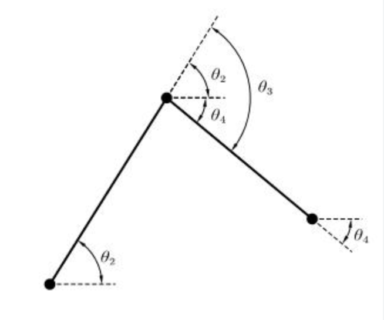

# 电控组技术指南
本指南用于存放电控组运动控制部分，队内涉及到的但是并不要求全部掌握的技术，在遇到相关技术问题时减少没有头绪乱撞的时间，这部分内容并不会很详细，更多的起到指导作用

## 目录
[一、机器人逆运动学与轨迹规划](#kinematics)  
[...]

## 一、机器人逆运动学与轨迹规划
### 简介
在调试机构时，通过机器人运动学，将控制接口封装好可以为调试提供极大的便利。  
  
例如：舵轮底盘有八个电机，但是在控制底盘运动时，输入量只有vx vy w。通过运动学解算，可以将底盘的调试接口变得简洁。  
  
类似的机械臂也可以实现类似的效果，对于位控：通过运动学解算机械臂运动接口封装成末端位姿，理论上可以实现，在机械臂工作空间内，将末端坐标x y z以及朝向（欧拉角或者四元数）作为输入量，机械臂从起点运动到目标点。  
  
另一方面，轨迹规划还可以让机构的末端运动实现特殊的运动轨迹，从而实现避障等功能，以及机械臂的动作连续化本身也可以提升一定效率。
### 机器人运动学
这部分内容比较偏理论，学院也安排的有相关课程，但很好理解，在这里只做简单的介绍。网上资料比较少，如果哪里不理解可以借助AI尝试理解一下，或在FAQ留言。  
  
首先，机器人运动学分为正运动学与逆运动学。正运动学：给出各个关节的角度，算出末端当前位姿（包括位置和朝向）；逆运动学：给出末端位姿，算出各个关节应有的角度。  
  
正运动学的求解比较容易理解，往往从底座开始向末端推，就能推出位置，在实际运用中用的也相对来说比较少，因为把这些关节角度代入到机构中可以显而易见的看到末端当前的状态，或者在机构失能状态下通过人为的拖动示教，也可以很清晰的看到末端位姿，这部分内容在行业内的应用主要在仿真器的内部设计等  
  
逆运动学的求解，在实战中的运用就更加的广泛一些，因为我们往往是希望机构末端或是机构整体，按照我们预想的动作去运动，这里“我们预想的动作”其实就可以理解为，一个与时间相关的末端位姿轨迹，有了这个轨迹其实也就有了末端状态，如何让机构运动到这个状态就是逆运动学的求解过程。逆运动学求解现在也有几种主流的方法，这里只介绍最容易理解的，也相对来说容易通过代码实现的方法——解析法，这里以二连杆平面机械臂为例子。  
   
图中展示的机械臂中的三个黑点，可以理解为三个关节，在底座处建立坐标系，以向右为x向上为y,如果此时两个连杆长度已知，定义机械臂沿x正向完全伸展为零位，规定各个关节逆时针为正向，末端所处坐标（x,y）已知，末端朝向（即theta4）已知。通过解三角形的方式不难算出三个关节此时的角度，在经过计算后，会得出两组解（如果再通过正运动学代入回去，两组解的区别就是，一组的小臂关节在上面，如图中所示，一组的小臂关节在下面，与图中机械臂姿态关于底座和末端连线轴对称，这也是解析法存在的不可避免的问题，随着自由度的增加，多解的问题还会逐渐更加严重，消除多解是逆运动学求解里重要的一步，通常通过引入约束来解决这个问题，例如限制大臂关节角度范围，从而直接删掉刚刚出现的第二组解，也可以采用别的限制手段。  
### 轨迹规划
通常机构末端运动规划包含路径规划和轨迹规划两部分，路径规划负责给出起点到终点避障的参考路径，轨迹规划将这条路径修改插值为满足一定限制条件的轨迹，对于固定任务，路径规划部分通常可以省略，改为拖动示教的方式，即手拖机构运动并记录关键点，所以在此处仅对轨迹规划做详细介绍。  
  
首先就是为什么要做轨迹规划，直接把关键点连起来形成一条折线，把折线上的点发给机构去运动存在什么问题。首先折线很显然的在拐角处存在速度的突变，如果这条轨迹以时间为自变量，速度就是轨迹方程的一阶导数，在拐角处速度突变，就意味着在很短的时间内速度从v0->v1，即在这段时间内需要一个接近无穷的加速度，根据牛顿运动定律，F=ma，也就意味着需要一个极大的力来实现这条轨迹的跟随，这种情况我们称之为冲击，冲击会对机构本身以及电机自身造成不好的影响，所以在将关键点连起来时通常要满足以下几点，起点和终点的速度、加速度（甚至加加速度jerk）为0，整条轨迹位置、速度、加速度、jerk连续无突变，轨迹的位置有闭式解，而满足以上特性的插值方式也有很多，常用的且用下来效果比较好的有Bezier(贝塞尔曲线)、B样条,下面介绍一下两种插值的曲线特点。Bezier：除起点和终点外，不会强制约束经过中间点，只会控制整体曲线在控制点围成的凸包内，整条曲线jerk连续，定义域为[0,1]；B样条是在bezier的基础上发展来的，bezier随着控制点增加，阶数会逐渐提升，计算量会逐渐增大，插值效果也会逐渐变差，B样条会将阶数控制在低阶，每次插值将相邻有限个关键点插值，在运动经过一个关键点后再向后迭代出下一条曲线，在处理高阶的插值问题时效果较好，除此之外，B样条还有多种形式，逼近B样条、插值B样条（严格经过每个给定的型值点），但是不同的形式连续性上和平滑性也有一定差别。Bezier通常就可以满足大部分需求，但是由于其不经过控制点的特性，特别是在锐角转角处，转角被磨平很严重，建议搭配matlab使用，绘图出整个机械臂的运动效果，并适当调整控制点，看看效果是否符合要求。  
  
轨迹规划的作用对象，轨迹规划包括笛卡尔空间的规划和关节空间规划，笛卡尔空间规划很容易理解，就是前面大部分时间提到的，机构末端在坐标系内的坐标点做插值，通过逆运动学不断求解，再下发到各个电机角度，但这种解法对于多解一定要控制好，以及对整体机构的姿态的感知也较弱。关节空间规划相对更容易实施，不需要考虑逆运动学的问题，对每个关节单独根据各个关键点的角度插值，得出这条轨迹中各个关节插值出的多项式，再直接将关节角度发给电机，可以解决逆运动学求解中的多解问题，实测效果并不差，但是关节空间规划同样存在问题，就是对与末端的运动状态的感知较弱，不过鉴于我们的运动规划轨迹来源是示教，其实也在一定程度上弥补了这个缺陷。（这里包括下面用关节空间举例仅仅只是我尝试过的一种方式，笛卡尔空间的规划在某种程度上其实更接近目前的机器人控制方式）  
  
关于轨迹规划的实战用法，目前我尝试过的做法是，首先保证电机的通信频率比较可观（1-200hz甚至更高），把时间作为轨迹自变量，根据前面关节空间规划出的轨迹，以固定的周期，代入各关节轨迹方程中，算出从运动开始的相对时刻，电机应处的位置，把该位置设为电机的目标位置。这里要注意bezier曲线的自变量定义域为0-1，设定的时间要除以周期来归一。为了实现这个效果，最大的难点在于电机自身的跟随效果，对于zdrive，我们以前是通过把加速度限制给大（几千甚至一万）（Z姥爷的博客上写着是给零，不知道他是不是更新固件时对这部分做了调整），或者是使用PVT模式。对于MIT控制，把kp给大效果提升很明显。dji系列电机本身由于控制频率很高，电机响应基本都还可以，把pid搓硬就可以。达妙的控制我研究的还不够深入，他的PV控制逻辑和Z有些区别，MIT控制也没有过多尝试，如果涉及到了达妙电机，可能需要后面再研究。  
